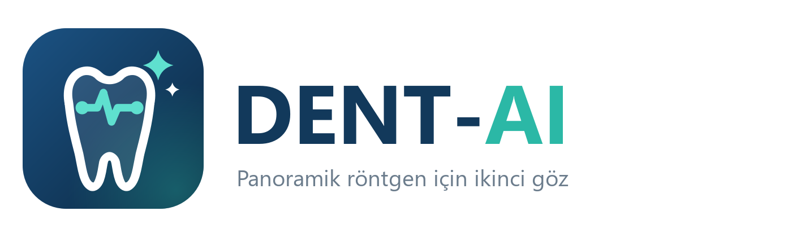
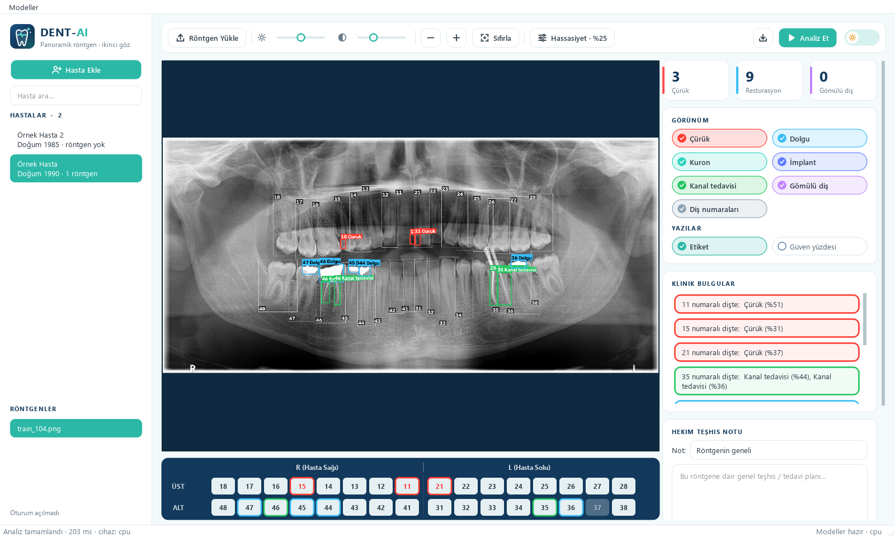
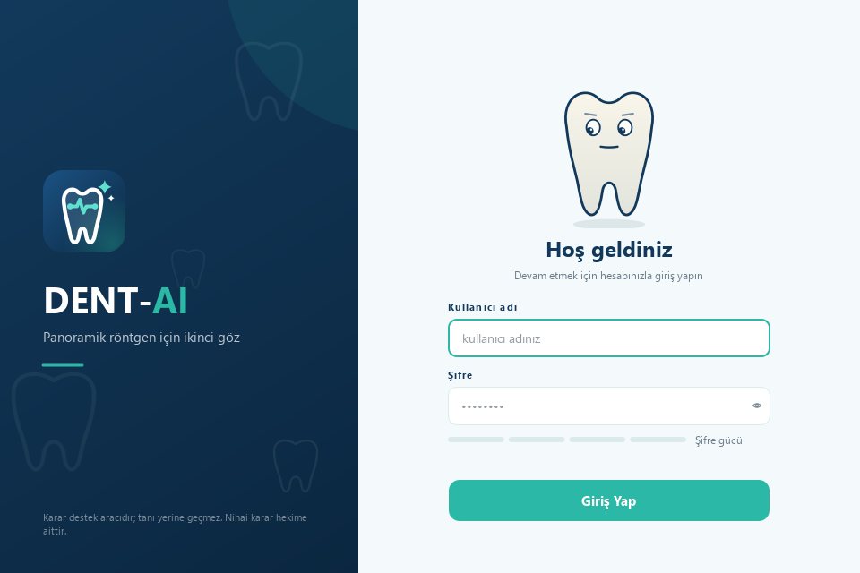
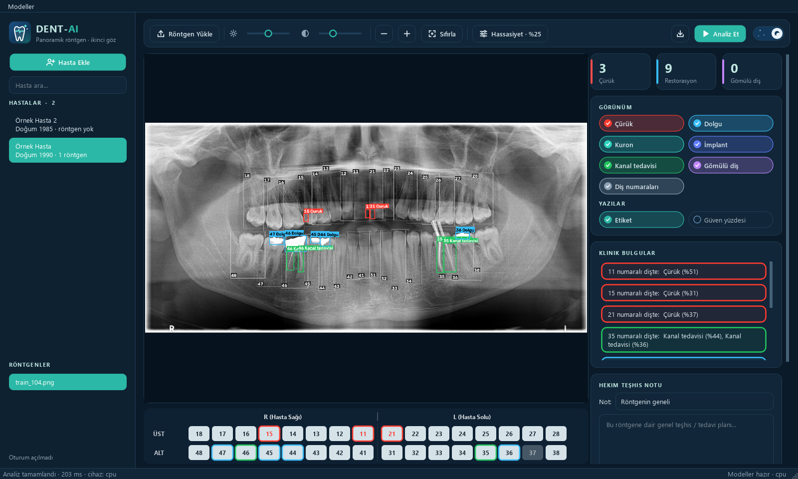

<p align="center">
  
</p>

<p align="center">
  Panoramik diş röntgenleri için masaüstü karar destek uygulaması
</p>

---

DENT-AI, panoramik röntgen üzerinde dişleri FDI sistemine göre numaralandırır, çürük, dolgu, kuron, implant, kanal tedavisi ve gömülü dişleri işaretler. Bulunan her bulguyu ait olduğu dişe bağlar, böylece hekim "36 numaralı dişte çürük" şeklinde bir liste görür. Amaç hekimin yerine karar vermek değil, röntgene ikinci bir gözle bakmaktır.

> Bu proje bir karar destek aracıdır, tanı koymaz. Klinik kullanım için bağımsız doğrulama gerekir; nihai karar hekime aittir.

<p align="center">
  
</p>

## Özellikler

- **Diş numaralandırma:** 32 kalıcı diş, FDI (11–48) numarasıyla.
- **Bulgu tespiti:** çürük, dolgu, kuron, implant, kanal tedavisi, gömülü diş.
- **Klinik bulgular listesi:** bulgular diş numarasıyla listelenir. Listeye ya da alttaki FDI çubuğuna tıklanınca o dişe yakınlaşılır.
- **Hasta kayıtları:** hasta eklenir, röntgenleri hastaya bağlanır. Hastaya tıklanınca röntgeni açılır.
- **Hekim teşhis notu:** röntgenin geneline ya da tek bir dişe not yazılabilir. Notlar kaydedilir, röntgen tekrar açıldığında geri gelir.
- **Görüntü araçları:** parlaklık, kontrast, yakınlaştırma, güven eşiği (hassasiyet), sınıf bazında katmanları açıp kapama.
- **Dışa aktarma:** işaretli görüntü (PNG) ve bulgular + notlar (JSON).
- Aydınlık / karanlık tema, kullanıcı girişi, sürükle-bırak ile röntgen yükleme.

<p align="center">
  
  &nbsp;
  
</p>

## Nasıl çalışıyor?

İki ayrı YOLOv8 modeli kullanılıyor:

1. **Diş modeli** röntgendeki dişleri bulur ve her birine FDI numarası verir.
2. **Bulgu modeli** röntgendeki bulguları bulur. Bu modelde görüntü önce CLAHE ile kontrastı artırılarak işlenir.

Ardından her bulgu kutusu, en çok örtüştüğü diş kutusuna atanır. Bu iki aşamalı yapının gerekçeleri [docs/ARCHITECTURE.md](docs/ARCHITECTURE.md) içinde anlatılıyor.

## Sonuçlar

Test kümesi eğitimde hiç kullanılmamış röntgenlerden oluşuyor. Veri %70 eğitim, %15 doğrulama, %15 test olarak bölündü. Aynı röntgenin farklı kopyaları (farklı boyut/kırpma) aynı bölmeye konarak test sızıntısı önlendi.

| Model | Sınıf | mAP50 |
|---|---|---|
| Diş numaralandırma | 32 diş (ortalama) | **0.943** |
| Bulgu | Gömülü diş | 0.927 |
| | İmplant | 0.912 |
| | Kuron | 0.813 |
| | Dolgu | 0.664 |
| | Kanal tedavisi | 0.651 |
| | Çürük | 0.357 |
| | **Ortalama** | **0.721** |

Çürük en zor sınıf: lezyonlar küçük ve röntgende belirsiz. Bu sınıfı iyileştirmek için çalışmalar sürüyor.

## Kurulum

Python 3.10 veya üstü gerekir.

```powershell
git clone https://github.com/Denizmrb/DENT-AI.git
cd DENT-AI
python -m venv .venv
.\.venv\Scripts\python.exe -m pip install -r requirements.txt
```

Eğitilmiş model dosyaları (`.pt`) boyutları nedeniyle depoda yok. `models/` klasörüne şu adlarla konmaları gerekir:

```
models/teeth_best.pt      diş numaralandırma modeli
models/findings_best.pt   bulgu modeli
```

## Kullanım

```powershell
.\.venv\Scripts\python.exe app.py                 # arayüz
.\.venv\Scripts\python.exe predict.py --source xray.jpg --show   # komut satırı
```

Giriş bilgileri [dentai/auth.py](dentai/auth.py) içinde tanımlıdır. Şifre düz metin olarak değil, PBKDF2 özeti olarak tutulur.

Hasta kayıtları ve notlar proje içindeki `kayitlar/` klasörüne kaydedilir. Bu klasör `.gitignore` ile depo dışında tutulur.

## Model eğitimi

Eğitimler Google Colab'da (T4 GPU) yapıldı: [notebooks/colab_train.ipynb](notebooks/colab_train.ipynb)

Veri setini hazırlamak için:

```bash
# DENTEX (COCO) etiketlerini YOLO biçimine çevirme
python -m dentai.data.prepare dentex --json train_quadrant_enumeration.json --images xrays --out raw/dentex_teeth --task teeth

# Bir veya birden çok kaynaktan %70/%15/%15 bölünmüş veri seti oluşturma
python -m dentai.data.prepare build --src raw/dentex_teeth --out datasets/teeth --task teeth
python -m dentai.data.prepare build --src raw/findings raw/dentex_findings --out datasets/findings \
       --task findings --clahe --map configs/map_findings.yaml
```

Farklı kaynaklardaki sınıf adları [configs/map_findings.yaml](configs/map_findings.yaml) ile ortak adlara eşlenir. Hedef sınıflar [configs/classes.yaml](configs/classes.yaml) dosyasındadır.

Eğitim:

```bash
python -m dentai.train.train --task teeth --data datasets/teeth/data.yaml --imgsz 1024
python -m dentai.train.train --task findings --data datasets/findings/data.yaml --imgsz 1024
```

## Proje yapısı

```
app.py                  masaüstü uygulaması
predict.py              komut satırından tahmin
dentai/
  inference/            iki aşamalı analiz, bulgu-diş eşleştirme, çizim
  data/prepare.py       veri hazırlama, bölme, tekrar eden görüntü kontrolü
  train/                YOLOv8 eğitimi ve test değerlendirmesi
  ui/                   arayüz (giriş ekranı, ana pencere, tema, logo)
  records.py            hasta kayıtları ve hekim notları
configs/                sınıflar, sınıf eşlemeleri, veri artırma ayarları
notebooks/              Colab eğitim defteri
tests/                  birim testleri
```

## Testler

```bash
python -m pytest -q
python scripts/smoke_test.py      # sentetik veriyle uçtan uca kontrol
```

## Veri setleri

- **DENTEX** — Hamamci, I. E. vd., *DENTEX: Dental Enumeration and Diagnosis on Panoramic X-rays Challenge*, MICCAI 2023.
- Roboflow Universe üzerindeki açık panoramik röntgen veri setleri.

Veri setleri ve röntgenler depoya dahil değildir; her biri kendi lisansına tabidir.

## Sınırlamalar

- Modeller yalnızca kalıcı dişler için eğitildi; süt dişleri numaralandırılmaz.
- Çürük tespiti henüz yeterince güvenilir değil (mAP50 0.36).
- Periapikal lezyon, kemik kaybı, kırık gibi bulgular şu an modelde yok.
- Dental yaş tahmini için arayüzde yer var ancak model henüz eğitilmedi.
